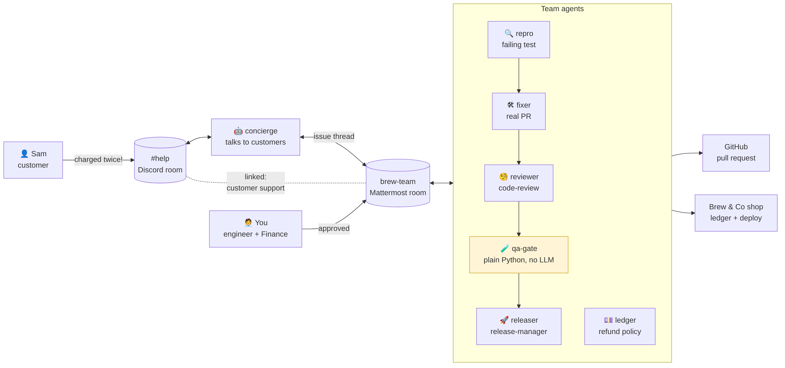

<div align="center">

# Full Circle

### One customer complaint in. A shipped fix and every affected customer refunded out.

**Seven AI agents and the humans who approve them close the loop across Discord and Mattermost, built on [Switch](https://github.com/sandbox-quantum/switch).**

[](https://youtu.be/t16srb8sR3o)
[](https://medium.com/@meet.bhorania/full-circle-i-built-a-team-of-7-ai-agents-that-turns-one-customer-complaint-into-a-shipped-fix-and-c6396b108b84)
[](https://www.wemakedevs.org/hackathons/switch)
[](LICENSE)

[How it works](#how-it-works) · [The agents](#the-agents) · [Why Switch](#why-switch-is-central) · [Run it yourself](#run-it-yourself) · [Author](#author)

</div>

---

| 🤖 **7 agents** | 💬 **2 apps** | 🧑‍⚖️ **Humans approve** | 🔀 **Real GitHub PRs** | 🧾 **Full audit log** |
|:---:|:---:|:---:|:---:|:---:|
| 6 Claude Code + 1 plain Python | Discord for customers, Mattermost for the team | Nothing ships and no money moves without a person | Fix, review and merge on GitHub | Every step and sign-off in an `INC` document |

## The problem

A customer writes *"I was charged twice."* In most companies that starts a slow relay: support copies it to the team chat, an engineer reproduces it, someone fixes it, someone reviews and deploys, finance refunds, and support finally replies. Every handoff loses context and time, and nobody sees the whole trail.

Worse: if a bug charged one customer twice, it probably charged others too. They just haven't complained yet.

## The scenario

**Brew & Co**, a small coffee shop, runs a flash sale. Thirty customers check out and a checkout bug silently charges **13 of them twice**. Then one customer, Sam, double-taps *Pay* on a bag of beans and complains on Discord.

A normal support flow refunds Sam and closes the ticket. **Full Circle treats Sam's message as a symptom:** the agents find the bug, fix it, ship it, then sweep the ledger and refund **every** customer it hit, with a £5 credit each. Because the total is over £50, the refund policy needs **two** people to approve: Finance *and* the engineering lead.

## How it works

| # | Step | Who | Where |
|---|---|---|---|
| 1 | Customer reports a double charge | Sam (customer) | Discord `#help` |
| 2 | Answers the customer, opens an issue thread for the team | **concierge** | Discord → Mattermost `brew-team` |
| 3 | Reproduces the bug with a failing test and finds everyone it affected | **repro** | `brew-team` |
| 4 | Fixes it in a separate worktree, opens a real pull request | **fixer** | `brew-team` + GitHub |
| 5 | Reviews the PR, requests changes when needed | **reviewer** | `brew-team` + GitHub |
| 6 | Tests, 10-click concurrency stress test, key-reuse check, privacy scan | **qa-gate** (plain Python, no LLM) | `brew-team` |
| 7 | Asks a person for sign-off, then merges and deploys | **releaser** + **you** | `brew-team` + GitHub |
| 8 | Refunds every affected customer plus £5 credits, under the refund policy | **ledger** + **you** (Finance, engineering lead) | `brew-team` |
| 9 | Tells the customer exactly what was approved | **concierge** | Discord `#help` |
| 10 | Writes the audit log with impact, total time and human approvals | **concierge** | `brew-team` document |

### Safety built in
- **Customers can't instruct the agents that touch code or money.** Switch refuses them. Only the concierge answers customers, and it can't promise anything.
- **Nothing ships and no money moves without a person writing "approved".** An agent's approval never counts, and an approval to ship code never covers a refund.
- **The repo is public, so agents never write customer data into code, tests or PRs.** qa-gate scans every diff for it.

## The agents

| Agent | Type | Job | Who can instruct it |
|---|---|---|---|
| **concierge** | Claude Code | Talks to customers, hands issues to the team, writes the audit log | Anyone |
| **repro** | Claude Code | Reproduces bugs with a failing test, measures the blast radius | Owner and owner's agents |
| **fixer** | Claude Code | Fixes in its own git worktree, opens a PR | Owner and owner's agents |
| **reviewer** | Claude Code, role `code-review` | Reviews PRs on GitHub | Owner and owner's agents |
| **qa-gate** | **Plain Python, no LLM** | Tests, stress test, key-reuse check, privacy scan | Owner and owner's agents |
| **releaser** | Claude Code, role `release-manager` | Merges and deploys after human sign-off | Owner and owner's agents |
| **ledger** | Claude Code | Refunds and credits under the refund policy, after human sign-off | Owner and owner's agents |

Each agent's settings and full instructions are in [`switch/agents/`](switch/agents/). qa-gate is in [`agents/qa-gate/`](agents/qa-gate/).

## Why Switch is central

Full Circle doesn't work without Switch. Every part of the workflow is a Switch feature:

| Switch feature | How Full Circle uses it |
|---|---|
| **Rooms on two messaging apps** | Customers on Discord, the team on Mattermost |
| **Linked rooms** | `brew-team` is linked to `#help` with the label "customer support" |
| **Addressing rules** | concierge: anyone. Everyone else: owner and owner's agents, so customers are refused |
| **Roles** | `code-review` (shared) and `release-manager` (exclusive: one agent ships at a time) |
| **Room instructions** | One briefing for the internal flow, one for the customer room |
| **Room documents** | `refund-policy` (read before every refund) and `INC-xxx` audit logs |
| **`!follow-ups off`** | Every instruction in `brew-team` must name the agent it's for |
| **Agent protocol** | qa-gate joins over the WebSocket protocol and works alongside the Claude Code agents |
| **Templates** | [`full-circle.template.yaml`](switch/full-circle.template.yaml) recreates the whole team in one step |

## Architecture



## Results

In an end-to-end run the loop closed in **17 min 38 s**, from the customer's message to telling the customer, with **2 human approvals** and a real merged pull request ([#2](https://github.com/meetbhorania/full-circle/pull/2)).

Things the agents did that nobody scripted:
- **ledger** refused to treat the approval to ship code as approval to move money, and waited for a separate one.
- **releaser** briefed the concierge in the private team room, not `#help`, because the customer can read `#help`, and listed what the customer must *not* be told.
- **reviewer** blocked the first PR for leaking customer data into a public repo. That became a permanent privacy rule.
- **repro** noticed the customer said "beans" but the ledger showed coffee prices, and flagged it instead of guessing.

## Run it yourself

**You need:** macOS, Docker, [Switch Console](https://github.com/sandbox-quantum/switch/releases/latest) v0.40.1, Claude Code (signed in), the GitHub CLI `gh` (signed in), and a Discord server you own.

1. **Clone and start the shop**
   ```bash
   git clone https://github.com/meetbhorania/full-circle.git && cd full-circle
   docker compose up -d --build
   open http://localhost:8000
   ```
2. **Start Switch.** In Switch Console: Add a server → Run a server on this computer → Start. Sign in to the bundled Mattermost.
3. **Connect Discord.** Create a bot in the Discord Developer Portal (Server Members + Message Content intents), invite it to your server, and connect it in Switch Console → Home → Connect → Discord. Link **your** Discord account and leave a second "customer" account unlinked. That's what makes Switch refuse the customer.
4. **Create the whole team in one step.** Switch Console → **Templates → Import template →** [`switch/full-circle.template.yaml`](switch/full-circle.template.yaml) **→ Use**. Fill in the path to your clone, pick Mattermost for the team and Discord for customers, then **Create**. This creates all six Claude Code agents, both rooms, the roles, the refund policy and the room link.
5. **Add qa-gate**, the plain-Python agent: see [`agents/qa-gate/README.md`](agents/qa-gate/README.md) (about 5 minutes).
6. **Turn on safety:** post `!follow-ups off` in `brew-team` once.
7. **Reset:** `./scripts/reset-demo.sh` puts the bug back and clears the ledger.
8. **Run the flash sale:** `./scripts/flash-sale.sh` (30 made-up customers, 13 silently double-charged).
9. **Play it:** as the customer, double-click **Pay now** on House Beans, then write to `@concierge` in `#help`. Approve in the brew-team thread with `@releaser approved`, `@ledger approved (Finance)` and `@ledger approved (engineering lead)`.

Setup notes and gotchas: [`docs/setup-notes.md`](docs/setup-notes.md). The planted bug: [`docs/the-bug.md`](docs/the-bug.md).

## Use it for your own team

Full Circle is a pattern, not a coffee-shop toy. Swap the agents' instructions and the policy document, and the same loop works anywhere one message needs several teams and a human sign-off:

| Business | Customer says | The loop |
|---|---|---|
| Online store | "I was charged the wrong price" | Find the pricing bug, fix it, refund everyone it hit |
| SaaS | "The dashboard is down for us" | Reproduce, patch, ship, credit affected accounts |
| IT helpdesk | "I can't log in" | Diagnose, fix access, manager approves |
| Insurance / banking | "My claim was rejected" | Check records, prepare payout, a person approves |
| Property management | "There's a leak" | Book a contractor within budget rules, landlord approves |

## Repo map

```
shop/                          Brew & Co demo shop (FastAPI) with the planted bug
switch/agents/                 Settings and instructions for the six Claude Code agents
switch/rooms/                  Room instructions for brew-team and #help
switch/documents/              Refund policy and incident-log format
switch/full-circle.template.yaml   One-step setup for the whole team
agents/qa-gate/                Plain-Python agent on the Switch agent protocol
scripts/flash-sale.sh          Flash sale that silently double-charges 13 customers
scripts/reset-demo.sh          Reset to a clean demo state
scripts/build_template.py      Regenerates the template from the files above
docs/                          Architecture, setup notes, the bug, demo script
```

## How I built this

Built solo during the hackathon. I used Claude as a pair programmer and dictated prompts and agent instructions with Wispr Flow. All code was reviewed, tested and committed by me. The full story is in the [blog post](https://medium.com/@meet.bhorania/full-circle-i-built-a-team-of-7-ai-agents-that-turns-one-customer-complaint-into-a-shipped-fix-and-c6396b108b84).

## Author

**Meet Bhorania** · AI Engineer, London

I build multi-agent systems, RAG pipelines and production AI for businesses, and co-founded the AI engineering consultancy Vaxion.

- 🌐 [meetbhorania.com](https://meetbhorania.com)
- 🐙 [github.com/meetbhorania](https://github.com/meetbhorania)
- ✍️ [medium.com/@meet.bhorania](https://medium.com/@meet.bhorania)
- ✉️ meet.bhorania@gmail.com

If Full Circle is useful to you, a ⭐ is appreciated.

## License

[MIT](LICENSE)
