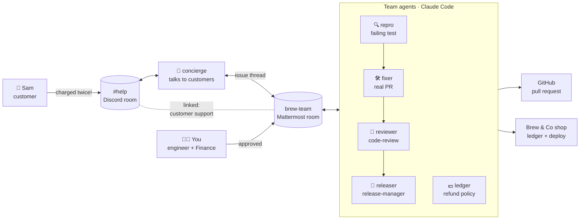

# Full Circle

**From a customer's message to a deployed fix and a refund, in one Switch workflow.**
Six AI agents and two people close the loop across Discord and Mattermost: reproduce, fix, review, approve, ship, refund and reply. A person signs off every risky step.

Built for the [Flip the Switch hackathon](https://www.wemakedevs.org/hackathons/switch) (Track 01: Best Business Workflow).

> 🎬 **Demo video:** _link added on submission_ · 📝 **Blog post:** _link added on submission_

---

## The problem

A customer writes "I was charged twice". Today that message lands in a support inbox, gets copied into the team chat, someone tries to reproduce it, someone else fixes it, someone reviews, someone deploys, finance refunds, and support finally replies. Every handoff loses context and time, and nobody can see the whole trail afterwards.

## What Full Circle does

| Step | Who | Where |
|---|---|---|
| 1. Customer reports a double charge | Sam (customer) | Discord `#help` |
| 2. Answers the customer, opens an issue thread for the team | **concierge** agent | Discord → Mattermost `brew-team` |
| 3. Reproduces the bug with a failing test, using the live ledger as evidence | **repro** agent | `brew-team` |
| 4. Fixes it in a separate worktree and opens a **real GitHub pull request** | **fixer** agent | `brew-team` + GitHub |
| 5. Reviews the PR on GitHub, requests changes when needed | **reviewer** agent (role `code-review`) | `brew-team` + GitHub |
| 6. Asks a person for sign-off, then merges and deploys | **releaser** agent (role `release-manager`) + **you** | `brew-team` + GitHub |
| 7. Proposes the refund under the room's refund policy, then pays it | **ledger** agent + **you, as Finance** | `brew-team` |
| 8. Tells the customer exactly what was approved | **concierge** | Discord `#help` |
| 9. Writes the audit trail (`INC-001`) with total time and human approvals | **concierge** | `brew-team` room document |

**Safety built in:**
- **Customers can't instruct the agents that touch code or money.** Switch refuses them. Only the concierge answers customers, and it can't promise anything.
- **Nothing ships and no money moves without a person writing "approved".** An agent's "approved" never counts.
- **The repo is public, so agents never write customer data into code, tests or PRs.**

## Why Switch is central

Full Circle doesn't work without Switch. Every part of the workflow is a Switch feature:

| Switch feature | How Full Circle uses it |
|---|---|
| **Rooms on two messaging apps** | Customers on Discord, the team on Mattermost (Telegram also connected) |
| **Linked rooms** | `brew-team` is linked to `#help` with the label "customer support" |
| **Room instructions** | One briefing for the internal flow, one for the customer-facing room |
| **Room documents** | `refund-policy` (read by the ledger agent before every refund) and `INC-xxx` audit logs |
| **Roles** | `code-review` (shared) and `release-manager` (exclusive), re-taken at the start of each session |
| **Addressing rules** | concierge: anyone. Everyone else: owner and owner's agents only, so customers are refused |
| **`!follow-ups off`** | Every instruction to an agent in `brew-team` must name it |
| **Agent-to-agent handoffs** | Agents hand work on by @-mentioning each other in the thread |
| **switch-buddy** | Built the room, roles, documents and all six agents from the files in [`switch/`](switch/) |

## Architecture



## Run it yourself

**You need:** macOS, Docker, [Switch Console](https://github.com/sandbox-quantum/switch/releases/latest) **v0.40.1**, Claude Code (signed in), the GitHub CLI `gh` (signed in), and a Discord server you own.

1. **Clone and start the shop**
   ```bash
   git clone https://github.com/meetbhorania/full-circle.git && cd full-circle
   docker compose up -d --build
   open http://localhost:8000
   ```
2. **Start Switch.** In Switch Console: Add a server → Run a server on this computer → Start. Sign in to the bundled Mattermost.
3. **Connect Discord.** Create a bot in the Discord Developer Portal (Server Members + Message Content intents), invite it to your server, and connect it in Switch Console → Home → Connect → Discord. Post a message in `#help` to turn it into a room. Link **your** Discord account; leave the customer account unlinked.
4. **Let switch-buddy build the team.** Paste the two messages in [`switch/setup-with-switch-buddy.md`](switch/setup-with-switch-buddy.md) into switch-buddy, with your folder path. It creates `brew-team`, the roles, the refund policy and all six agents from [`switch/agents/`](switch/agents/).
5. **Invite the customer-facing agents** in Discord `#help`: `!invite-agent @concierge` and `!invite-agent @releaser`.
6. **Reset before each run:** `./scripts/reset-demo.sh`
7. **Play it:** as the customer, double-click **Pay now** on House Beans, then write to `@concierge` in `#help`.

Full setup notes and the gotchas we hit are in [`docs/setup-notes.md`](docs/setup-notes.md).

## The planted bug

The checkout ignores the idempotency key the page sends, and the Pay button stays clickable while the (deliberately slow) payment provider answers. A double-click charges the same order twice. Spoilers: [`docs/the-bug.md`](docs/the-bug.md).

## Result of a full run

In rehearsal 2 the whole loop ran end to end, and the concierge closed it in `INC-001`:

> **17 min 38 s** from the customer's message to telling the customer, with **2 human approvals** (ship, refund) and a real merged pull request ([#2](https://github.com/meetbhorania/full-circle/pull/2)).

Along the way the agents did things nobody scripted:
- **repro** noticed the customer said "beans" but the ledger showed flat-white prices, and flagged it instead of guessing.
- **ledger** pointed out that the "approved" given for shipping didn't cover money, and waited for a separate approval.
- **releaser** briefed the concierge in the team room, not in `#help`, because the customer can read `#help`, and listed what the customer must *not* be told.

## What we learned (and fixed) in rehearsals

Rehearsal 1 surfaced real problems, and the agents reported every one honestly:
- **repro** noticed that saving a test file auto-reloaded the shop and wiped the in-memory ledger, kept a snapshot, and said so. → The ledger is now persisted to disk, auto-reload is off, and tests run against their own temporary ledger.
- **ledger** refused to "refund" a charge it couldn't verify. That is exactly the behaviour you want from an agent that moves money.
- **reviewer** blocked the first PR for leaking customer data into a public repo and for accepting a reused key with a different order. → A privacy rule and a 409 requirement are now in the instructions.

## Repo map

```
shop/                 Brew & Co demo shop (FastAPI) with the planted bug
switch/agents/        Settings and instructions for each of the six agents
switch/rooms/         Room instructions for brew-team and #help
switch/documents/     Refund policy and incident-log format
switch/setup-with-switch-buddy.md   The messages that build everything
scripts/reset-demo.sh Reset to a clean demo state
docs/                 Setup notes, the bug, demo script
```

## How I built this

Built solo during the hackathon by [Meet Bhorania](https://meetbhorania.com). I used Claude as a pair programmer and dictated prompts and instructions with Wispr Flow. All code was reviewed, tested and committed by me.

## License

MIT
